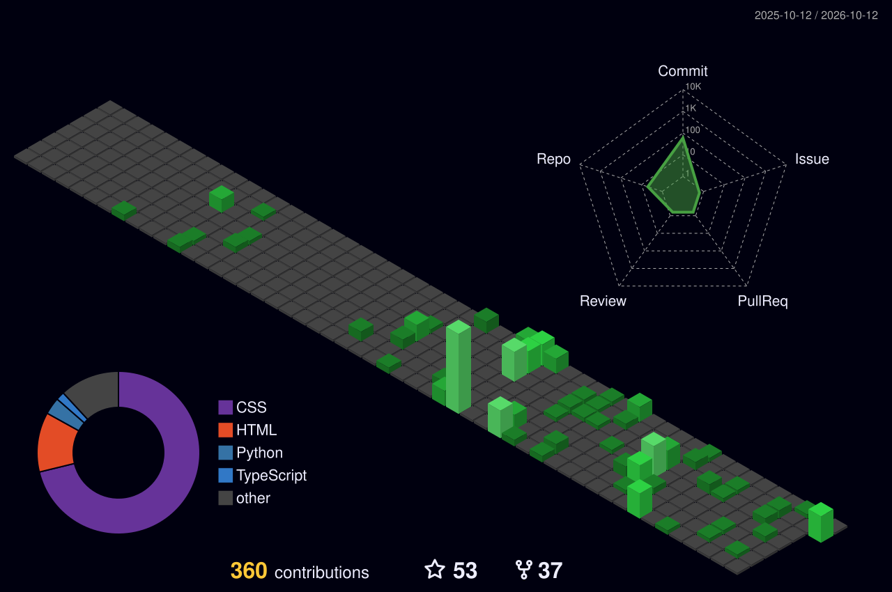

### hey there 

 

hi, i'm **Amit Yadav**, an Independent AI Consultant & Systems Engineer.  
I build advanced, mission-critical systems across **medical AI, robotics perception, real-time inference optimization, and cognitive architectures**.

I work end-to-end on ambitious, high-stakes builds—from mathematical formulation and custom neural architectures to low-level hardware acceleration and distributed cluster orchestration.

---

- AI Consultant & Systems Architect (advisory, performance audits, greenfield builds)
- Medical AI & 3D Volumetric Imaging (CT/MRI segmentation, surgical vision)
- Physical AI & Robotics Perception (ROS2, embedded spatial vision, Nvidia Warp)
- Low-latency inference optimization & custom CUDA kernels
- Stateful cognitive architectures & internal world simulation
- CKA-certified Kubernetes cluster orchestration & bare-metal ML infrastructure

Contact & Advisory: **amitech90@gmail.com**

---

### current focus

- 3D medical vision & intraoperative surgical guidance (MONAI, DICOM streaming)
- real-time robotics perception & spatial computing on edge hardware (ROS2, TensorRT)
- low-latency inference pipelines (custom CUDA backends, quantization, Triton, vLLM)
- stateful cognitive systems (hierarchical memory, metacognition, internal simulation)
- bare-metal multi-GPU orchestration & cluster reliability (CKA certified)

---

### languages & tools

<code></code>
<code></code>
<code></code>
<code></code>
<code></code>
<code></code>
<code></code>
<code></code>
<code></code>

---

### selected work & architectures

- **Volumetric Medical Diagnostic & Surgical Guidance Mesh**  
  End-to-end clinical perception pipeline processing high-density 3D CT/MRI scans and intraoperative video feeds. Combines MONAI backbones with zero-copy C++ streaming for real-time anatomical boundary detection and surgical instrument localization.

- **Low-Latency Inference Optimization Runtime**  
  Customized inference execution runtime built to eliminate off-the-shelf framework overhead. Features tailored CUDA kernel integration, FlashAttention memory optimizations, and INT4/FP8 quantization (AWQ/GPTQ) for deterministic, high-throughput model serving.

- **Stateful Cognitive Architecture & Internal World Simulator**  
  A computer-realizable cognitive topology designed to move beyond stateless autoregressive chatbots. Incorporates decoupled perception modules, hierarchical memory stores (working, episodic, semantic), a metacognitive governor, and an asynchronous internal simulation loop ("dream state") for offline counterfactual reasoning and hypothesis testing.

- **Embedded Edge Robotics Perception Engine**  
  Autonomous spatial perception and sensor fusion pipeline running at a steady 60 FPS on embedded edge hardware. Couples ROS2 with optimized TensorRT backends for visual odometry, real-time tracking, and dynamic collision avoidance.

- **Distributed Multi-GPU Compute Mesh**  
  High-availability bare-metal Kubernetes deployment (CKA certified) on Debian Linux tailored for distributed model inference, featuring automated node failover, dedicated GPU workload isolation, and zero-downtime rolling updates.

